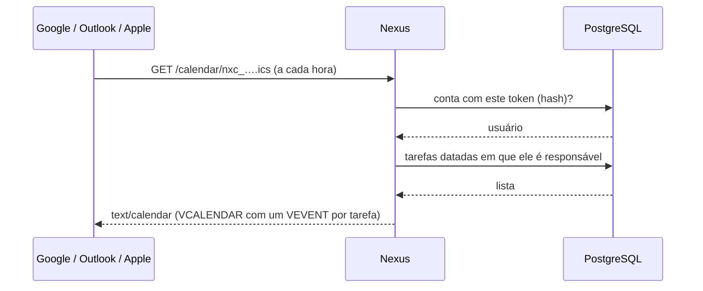

# Calendário (feed iCal)

!!! abstract ""
    As tarefas com prazo aparecem no Google Calendar, no Outlook ou no Apple Calendar como um
    **calendário de assinatura**, que se atualiza sozinho. Sem OAuth, sem instalar nada: é uma URL
    no formato iCalendar (`.ics`). Issue #68.

## Em um minuto

| | |
|---|---|
| Onde | Minha conta → **Calendário** → "Gerar a URL do feed" |
| O que entra | As tarefas em que **você é responsável** e que têm data de início ou prazo, de todos os seus workspaces |
| Formato | Eventos de dia inteiro, do início ao prazo (`TASK-12 Título`); concluídas ganham ✓ e somem depois de 30 dias |
| Atualização | Os calendários consultam a URL por conta própria, em geral a cada hora (`REFRESH-INTERVAL:PT1H`) |
| Segurança | A URL carrega um token: quem a tiver lê o feed. "Gerar outra URL" ou "Desativar" invalida a anterior na hora |
| Só leitura | Mudar o evento no calendário não muda a tarefa |

## Assinar

- **Google Calendar** (no computador): ao lado de "Outros calendários", **+** → *Por URL* → colar
  a URL. No celular o calendário aparece depois de ativado no computador.
- **Outlook** (web ou desktop): *Adicionar calendário* → *Assinar da Web* → colar a URL e dar um
  nome.
- **Apple Calendar** (Mac): *Arquivo* → *Nova assinatura de calendário*. **iPhone**: Ajustes →
  Calendário → Contas → Adicionar conta → Outro → *Adicionar calendário assinado*.

## Como o feed é montado



- O token é `nxc_` + 43 caracteres aleatórios. O banco guarda o **hash** (para achar a conta) e
  uma cópia **cifrada** pelo Data Protection (para a tela mostrar a URL de novo). Código em
  `CalendarFeedService`.
- Rota anônima de propósito (os calendários não fazem login), com limite de 60 chamadas por
  minuto por IP, só para conter varredura de tokens. Token desconhecido: `404`, sem detalhe.
- Cada evento leva `UID` estável (o id da tarefa), `URL` para a lista no Nexus, `CATEGORIES` com
  o workspace e a descrição com workspace, lista, status e o começo da descrição da tarefa.
- `DTEND` é o dia seguinte ao prazo, como manda o iCalendar para eventos de dia inteiro. Uma
  tarefa só com início vira um evento de um dia; só com prazo, idem.

## Exemplo

```text
BEGIN:VCALENDAR
VERSION:2.0
PRODID:-//Aamora//Nexus//PT-BR
X-WR-CALNAME:Nexus · Minhas tarefas
REFRESH-INTERVAL;VALUE=DURATION:PT1H
BEGIN:VEVENT
UID:9b2e4c1a-...@nexus.aamora.com.br
DTSTART;VALUE=DATE:20261123
DTEND;VALUE=DATE:20261126
SUMMARY:TASK-12 Separar pedido 1001
DESCRIPTION:Acme · Pedidos · A fazer\n\nCliente pediu entrega até sexta.
URL:https://nexus.aamora.com.br/lists/4f1c.../list
CATEGORIES:Acme
END:VEVENT
END:VCALENDAR
```

## Perguntas comuns

**Quero ver todas as tarefas do workspace, não só as minhas.** Por enquanto o feed é pessoal
(responsável). Um feed por workspace está na lista do que vem depois; se precisar, abra uma issue.

**Mudei o prazo e o calendário não atualizou.** O calendário é quem decide quando buscar de novo;
o Google pode levar até um dia. Remover e assinar de novo força a atualização.

**Perdi o celular com a URL assinada.** Minha conta → Calendário → *Gerar outra URL*. A antiga para
na hora.
