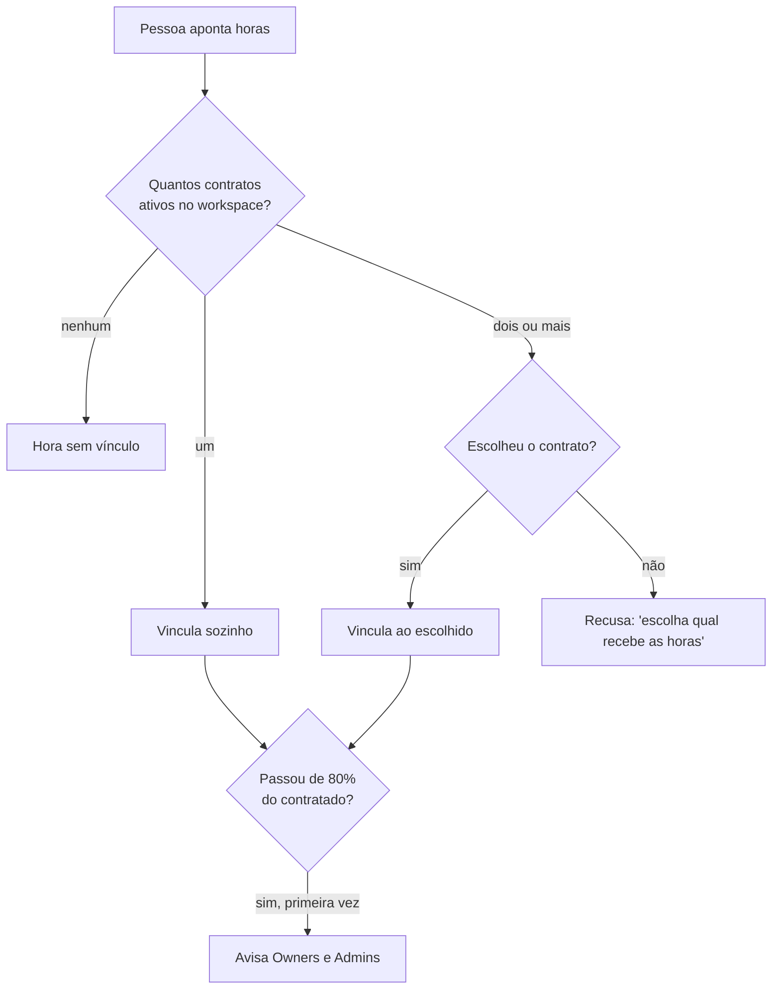

# Horas e Contratos

!!! abstract ""
    Para quem vende horas: cada workspace tem contratos com o cliente, e cada pessoa aponta o tempo
    trabalhado, por timer ou à mão, numa tarefa ou avulso. O saldo do contrato é o contratado menos o
    apontado. Issues #77
    e #78.

## Em um minuto

| | |
|---|---|
| Onde | Aba **Horas** do workspace, e a seção **Horas** no painel de cada tarefa |
| Quem aponta | Qualquer membro, as próprias horas. Admin edita e apaga as de todos |
| Como | Timer (iniciar e parar) ou lançamento manual: data, horas, atividade, tarefa ou avulso, contrato, comentário |
| Contratos | Owner e Admin cadastram; todos veem o saldo |
| Relatório | Admin: por pessoa, lista, contrato, atividade ou dia, com planilha `.xlsx` |
| API | `GET` e `POST /api/v1/time-entries` |

## A regra do contrato



- **Travado** ou **encerrado** não recebe hora nova. Lançamentos já vinculados continuam contando.
- O aviso de 80% sai uma vez por contrato; se as horas contratadas aumentarem e o consumo voltar
  para baixo de 80%, ele pode sair de novo.
- Apagar um contrato deixa as horas, sem vínculo. Apagar uma tarefa deixa as horas como avulsas.

## Timer

- Um timer por pessoa, em qualquer workspace. Iniciar outro pede para parar o atual.
- Parar grava o lançamento com minutos inteiros (mínimo um): 7 min 40 s viram 0,13 h.
- Com dois ou mais contratos ativos, parar pergunta o contrato e deixa o timer rodando até a
  escolha. "Descartar" apaga o timer sem lançamento.

## Lançamento manual

| Campo | Regra |
|---|---|
| Data | Entre um ano atrás e amanhã |
| Horas | De 0,01 a 24 por lançamento, duas casas |
| Atividade | Lista por workspace (Desenvolvimento, Reunião, Suporte, Análise, Outra; Admin edita em Horas → Atividades) |
| Tarefa | Pelo código (`TASK-12`) ou vazio para hora avulsa |
| Contrato | Pela regra acima |
| Comentário | Até 500 caracteres |

## Relatório e planilha

Em **Horas → Relatório** (Admin): período, agrupamento e participação de cada linha no total.
"Planilha" baixa `/workspaces/{id}/hours/export.xlsx?from=AAAA-MM-DD&to=AAAA-MM-DD` com uma linha
por lançamento (data, pessoa, tarefa, lista, atividade, contrato, horas, comentário) e o total.
Members baixam só as próprias horas.

## API

```bash
# listar o mês atual (ou from/to, userId, taskId, contractId)
curl -H "Authorization: Bearer nxk_..." "https://nexus.aamora.com.br/api/v1/time-entries?from=2026-11-01&to=2026-11-30"

# registrar 1,5 h de um membro numa tarefa
curl -X POST -H "Authorization: Bearer nxk_..." -H "Content-Type: application/json" \
  https://nexus.aamora.com.br/api/v1/time-entries \
  -d '{ "userId": "<id de GET /members>", "date": "2026-11-17", "hours": 1.5, "taskId": "<id>", "comment": "Importado do ponto" }'
```

`userId` é obrigatório: a chave é do workspace, não de uma pessoa. As mesmas regras valem (membro,
contrato, horas). Ferramentas MCP de horas chegam na próxima versão.

## Por baixo

- `WorkspaceContract`, `TimeActivity`, `TimeEntry` (data como meia-noite UTC, horas `decimal(6,2)`),
  `RunningTimer` (um por pessoa). Código em `src/Nexus.Web/Services/TimeTracking/`.
- Toda hora passa por `TimeTrackingService.LogAsync`, venha da tela, do timer, do painel da tarefa
  ou da API. É ali que ficam as validações e a regra do contrato.
