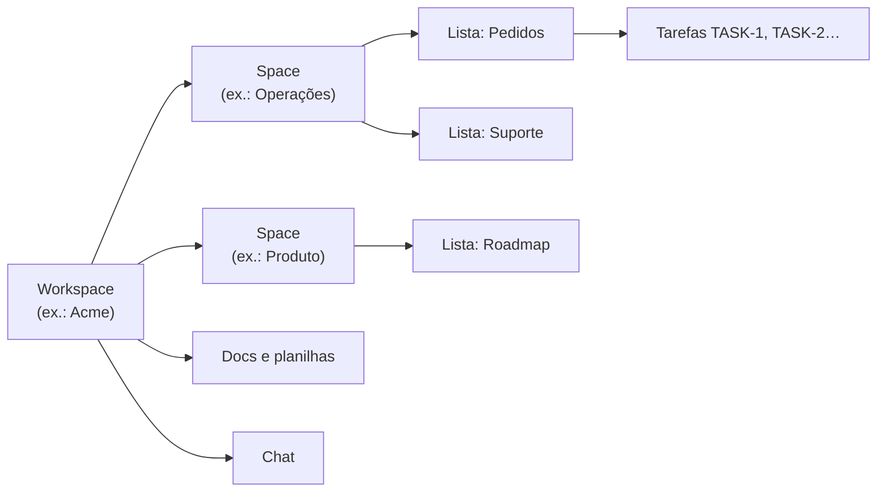

# Guia do usuário

O Nexus organiza o trabalho em **workspaces**: cada cliente, equipe ou projeto grande tem o seu,
com os próprios membros, quadros, docs e chat. Dentro do workspace, **spaces** agrupam **listas**
de tarefas, e cada lista tem as próprias colunas de status.

## Por onde começar

1. **Crie a conta** em <https://nexus.aamora.com.br> e confirme o e-mail.
2. **Crie um workspace** ou aceite o convite que alguém mandou.
3. Dentro dele, **crie um space e uma lista**: a lista já nasce com os status "A fazer", "Fazendo"
   e "Feito".
4. **Crie a primeira tarefa**. Ela ganha um código (`TASK-1`) que serve para citá-la no chat, nos
   docs e na API.
5. **Convide a equipe** em Membros. Cada pessoa tem um papel: Owner, Admin ou Member.

## As páginas deste guia

| Página | O que cobre |
|---|---|
| [Workspaces, spaces e listas](workspaces.md) | Estrutura, membros e papéis, configurações do workspace |
| [Tarefas, quadro e backlog](tarefas.md) | Criar e editar tarefas, visões em lista e quadro, fluxo de status, campos personalizados, etiquetas |
| [Sprints, Gantt e calendário](planejamento.md) | Planejar por sprint, burndown, linha do tempo e calendário |
| [Docs e planilhas](docs-e-planilhas.md) | Documentos e planilhas colaborativos do workspace |
| [Chat e notificações](chat.md) | Chat do workspace, grupos, conversas diretas, menções e notificações |
| [Conta e segurança](conta.md) | Perfil, senha, verificação em duas etapas, passkeys e seus dados |
| [Calendário (feed iCal)](calendario.md) | Suas tarefas com prazo no Google Calendar, Outlook ou Apple Calendar |
| [Horas e contratos](horas-e-contratos.md) | Timer, lançamento de horas, contratos com o cliente, relatório e planilha |
| [Check-in semanal](check-in.md) | O resumo semanal do workspace: percepção e quatro campos |
| [Planos](planos.md) | O que cada plano inclui |

!!! note "Guia em construção"
    Esta seção está sendo escrita por partes. As páginas já trazem o essencial de cada módulo;
    capturas de tela e passo a passo detalhado chegam nas próximas versões.
