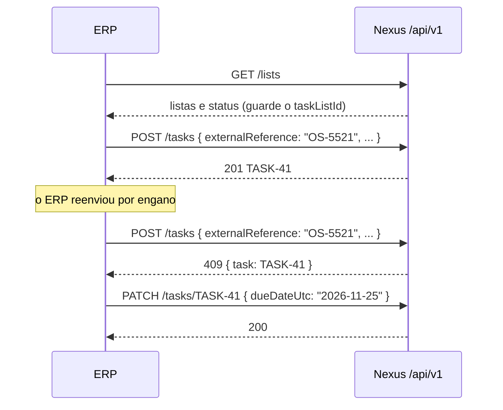

# Receitas de Integração

!!! abstract ""
    Cenários completos com a [API de Integração](api.md). Troque `nxk_sua_chave` pela chave
    gerada em **Configurações → Integrações** e `https://nexus.aamora.com.br` pelo endereço do seu Nexus.

## Receita 1: ERP que cria tarefas

O caso que motivou a API: o ERP gera uma demanda (um pedido, uma ordem de serviço) e ela precisa
virar tarefa no quadro da equipe.



### curl

```bash
NEXUS=https://nexus.aamora.com.br
KEY=nxk_sua_chave

# 1. listas e status
curl -s $NEXUS/api/v1/lists -H "Authorization: Bearer $KEY"

# 2. criar
curl -s -X POST $NEXUS/api/v1/tasks \
  -H "Authorization: Bearer $KEY" -H "Content-Type: application/json" \
  -d '{
    "taskListId": "4f1c...",
    "title": "OS 5521 · Manutenção preventiva linha 2",
    "description": "Aberta no ERP por Carla. Prioridade do cliente: alta.",
    "priority": "High",
    "dueDateUtc": "2026-11-25",
    "externalReference": "OS-5521"
  }'

# 3. atualizar pelo código
curl -s -X PATCH $NEXUS/api/v1/tasks/TASK-41 \
  -H "Authorization: Bearer $KEY" -H "Content-Type: application/json" \
  -d '{ "dueDateUtc": "2026-11-27" }'
```

### C# (.NET 8+)

```csharp
using System.Net.Http.Headers;
using System.Net.Http.Json;

var http = new HttpClient { BaseAddress = new Uri("https://nexus.aamora.com.br/api/v1/") };
http.DefaultRequestHeaders.Authorization = new AuthenticationHeaderValue("Bearer", "nxk_sua_chave");

var response = await http.PostAsJsonAsync("tasks", new
{
    taskListId = "4f1c...",
    title = "OS 5521 · Manutenção preventiva linha 2",
    priority = "High",
    dueDateUtc = new DateTime(2026, 11, 25, 0, 0, 0, DateTimeKind.Utc),
    externalReference = "OS-5521",
});

if (response.StatusCode == System.Net.HttpStatusCode.Conflict)
{
    // Já existia: a tarefa vem dentro de "task". Use o id dela daqui em diante.
    var conflict = await response.Content.ReadFromJsonAsync<ConflictBody>();
    Console.WriteLine($"Já era a {conflict!.Task.Code}");
}
else
{
    response.EnsureSuccessStatusCode();
    var task = await response.Content.ReadFromJsonAsync<TaskBody>();
    Console.WriteLine($"Criada {task!.Code}: {task.Url}");
}

record TaskBody(Guid Id, string Code, string Title, string Url);
record ConflictBody(string Message, TaskBody Task);
```

### Python

```python
import requests

NEXUS = "https://nexus.aamora.com.br/api/v1"
HEADERS = {"Authorization": "Bearer nxk_sua_chave"}

r = requests.post(f"{NEXUS}/tasks", headers=HEADERS, json={
    "taskListId": "4f1c...",
    "title": "OS 5521 · Manutenção preventiva linha 2",
    "priority": "High",
    "dueDateUtc": "2026-11-25",
    "externalReference": "OS-5521",
})

if r.status_code == 409:
    task = r.json()["task"]          # já existia
elif r.status_code == 400:
    raise SystemExit(r.json()["errors"])  # {"title": ["Informe o título."], ...}
else:
    r.raise_for_status()
    task = r.json()

print(task["code"], task["url"])
```

## Idempotência

Redes falham e filas reentregam. Para o ERP poder repetir uma chamada sem medo:

- **Sempre mande `externalReference`** com o id da tarefa no seu sistema. A segunda chamada com a
  mesma referência responde `409` e devolve a tarefa que já existe em `task`. Trate `201` e `409`
  como sucesso e guarde o `id` (ou o `code`) retornado.
- **Guarde o `id` do Nexus** ao lado do registro no ERP. Depois disso, atualize por `PATCH /tasks/{id}`
  e não dependa mais da referência.
- **`PATCH` é naturalmente repetível**: mandar o mesmo corpo duas vezes deixa a tarefa igual. A única
  exceção é o `409` sem `task`, que quer dizer "alguém editou a tarefa enquanto você chamava":
  leia com `GET` e repita o `PATCH`.

## Receita 2: sincronização incremental

Como o Nexus ainda não avisa o ERP quando algo muda, o ERP pergunta de tempos em tempos o que mudou.

```python
import requests, datetime as dt

NEXUS = "https://nexus.aamora.com.br/api/v1"
HEADERS = {"Authorization": "Bearer nxk_sua_chave"}

def changed_since(since: dt.datetime):
    page = 1
    while True:
        r = requests.get(f"{NEXUS}/tasks", headers=HEADERS, params={
            "updatedSince": since.isoformat(),
            "page": page, "pageSize": 100,
        })
        r.raise_for_status()
        body = r.json()
        yield from body["items"]
        if page * body["pageSize"] >= body["total"]:
            return
        page += 1

# last_run: o instante da varredura anterior, guardado do lado do ERP
# (na primeira vez, uma data antiga o bastante para trazer tudo)
last_run = erp.ler_ultima_sincronizacao()

# guarde o instante ANTES de começar a varredura, e use-o como "since" da próxima rodada
started = dt.datetime.now(dt.timezone.utc)
for task in changed_since(last_run):
    if task["status"]["category"] == "Done":
        erp.fechar_os(task["externalReference"])
last_run = started
```

Pontos de atenção:

- Use o instante em que a varredura **começou** como `updatedSince` da próxima, não o instante em que
  terminou: uma tarefa alterada durante a varredura não é perdida (pode aparecer duas vezes, o que é
  inofensivo).
- `updatedSince` olha `updatedAtUtc` e, para tarefas nunca editadas, `createdAtUtc`. Tarefas novas
  entram no resultado.
- Com 120 chamadas por minuto e 100 itens por página, uma varredura cobre 12.000 tarefas por
  minuto. Para um workspace comum, uma chamada basta.

## Receita 3: mapear status e responsáveis

O ERP tem os seus próprios status e usuários; o Nexus tem os dele. Faça o mapeamento uma vez e
guarde-o do lado do ERP:

```python
lists = requests.get(f"{NEXUS}/lists", headers=HEADERS).json()
pedidos = next(l for s in lists for l in s["lists"] if l["name"] == "Pedidos")
status_por_nome = {st["name"]: st["id"] for st in pedidos["statuses"]}
status_inicial = next(st["id"] for st in pedidos["statuses"] if st["isDefault"])

members = requests.get(f"{NEXUS}/members", headers=HEADERS).json()
membro_por_email = {m["email"].lower(): m["id"] for m in members if m["email"]}
```

- Prefira mapear por **e-mail** (membros) e por **nome** (status); ids mudam se alguém recriar a
  lista.
- Um `assigneeId` que não é membro responde `400` com erro em `assigneeId`. Trate como "deixar sem
  responsável e avisar", em vez de falhar a importação inteira.
- Para mover de status, respeite o fluxo da lista: se `PATCH` responder `400` em `statusId` com a
  mensagem de transição não permitida, a lista tem regras (configuradas em **Fluxo de trabalho**)
  e o caminho precisa passar pelos status intermediários.

## Receita 4: script de importação única

Para migrar uma planilha ou um sistema antigo de uma vez:

```powershell
$Nexus = "https://nexus.aamora.com.br/api/v1"
$Headers = @{ Authorization = "Bearer nxk_sua_chave" }

Import-Csv tarefas.csv | ForEach-Object {
    $body = @{
        taskListId        = "4f1c..."
        title             = $_.Titulo
        description       = $_.Descricao
        dueDateUtc        = $_.Prazo          # "2026-11-25"
        externalReference = "PLANILHA-" + $_.Linha
    } | ConvertTo-Json
    try {
        Invoke-RestMethod "$Nexus/tasks" -Method Post -Headers $Headers -ContentType "application/json; charset=utf-8" -Body $body | Out-Null
    } catch {
        if ($_.Exception.Response.StatusCode.value__ -eq 409) { return }   # já importada
        Write-Warning "Linha $($_.Linha): $($_.ErrorDetails.Message)"
    }
}
```

`externalReference` com o número da linha torna o script reexecutável: rodar de novo pula o que já
entrou.

## Erros e tentativas

| Resposta | Repetir? | Como |
|---|---|---|
| `429` | sim | Espere alguns segundos (o limite é por minuto) e repita a mesma chamada |
| `5xx` ou falha de rede | sim | Repita com espera crescente (1 s, 2 s, 4 s…). `POST` com `externalReference` e `PATCH` são seguros de repetir |
| `409` sem `task` | sim | `GET` a tarefa e repita o `PATCH` |
| `400`, `404` | não | O corpo diz o que corrigir |
| `401` | não | A chave foi revogada ou está errada: gere outra na tela |
| `403` | não | O workspace está arquivado |

## Testar sem produção

Rode o Nexus localmente ([Como Rodar Localmente](https://gitlab.com/senac-projetos-de-desenvolvimento/2025-pedro-gentil/tcc_2/nexus/-/wikis/Como-Rodar-Localmente)), crie um workspace, gere uma
chave e aponte o script para `http://localhost:5289/api/v1`. A especificação local fica em
`http://localhost:5289/openapi/v1.json` e pode ser importada no Postman, no Insomnia ou no Bruno.
