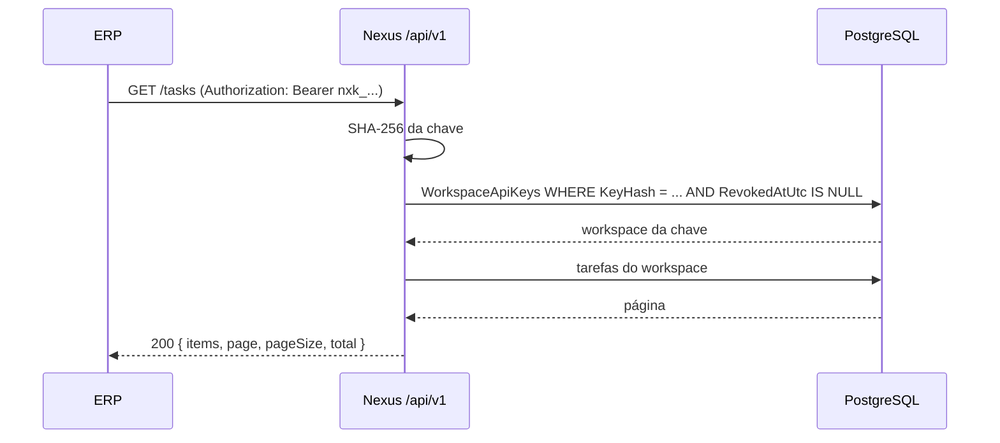

# API de Integração

!!! abstract ""
    Para um ERP, um script ou qualquer sistema criar e acompanhar tarefas de um workspace sem ninguém
    digitar nada de novo no Nexus. Issue #66.
    A referência completa de cada rota está em [Referência da API](api-referencia.md) e os
    exemplos prontos em [Receitas](api-receitas.md).

## Em um minuto

| | |
|---|---|
| Base | `https://nexus.aamora.com.br/api/v1` |
| Formato | JSON em UTF-8, nos dois sentidos |
| Autenticação | `Authorization: Bearer nxk_...` (chave de API do workspace) |
| Especificação | [`/openapi/v1.json`](https://nexus.aamora.com.br/openapi/v1.json), gerada pelo próprio app |
| Limite | 120 chamadas por minuto por chave |
| Escopo desta versão | workspace, listas e status, membros, tarefas (criar, listar, buscar, atualizar), horas e check-in semanal |

## Chaves de API

Uma chave pertence a **um** workspace e só enxerga ele. Quem gera é Owner ou Admin, em
**Configurações do workspace → Integrações**:

1. Dê um nome à chave, de preferência o do sistema que vai usá-la ("ERP Protheus", "Script de
   importação").
2. Copie o valor completo (`nxk_` seguido de 43 caracteres). **Ele aparece uma única vez.** O Nexus
   guarda só o SHA-256; a lista mostra apenas o prefixo (`nxk_a1b2c3…`), a data de criação e o
   último uso.
3. Escolha o escopo: *leitura e escrita* (para um ERP) ou *só leitura* (para painéis e relatórios,
   que não devem conseguir criar nada). Uma chave só de leitura recebe `403` em `POST` e `PATCH`.
4. Revogar corta o acesso na hora. Cada workspace pode ter até 20 chaves ativas.

A API faz parte dos planos **Pro e Business**. Um workspace que volta ao Starter recebe `403` em
toda chamada e volta a funcionar ao assinar de novo, com as mesmas chaves.

Criação e revogação vão para o log de auditoria, com quem fez e qual chave.



Por baixo, isso é um esquema de autenticação próprio (`ApiKey`), escrito no padrão
`AuthenticationHandler` do ASP.NET Core
(`ApiKeyAuthenticationHandler.cs`).
Só as rotas de `/api/v1` pedem esse esquema. O restante do app continua no cookie do Identity, e
a chave nunca serve para abrir uma tela.

## Respostas de erro

Erros vêm como `application/problem+json`
([RFC 9457](https://www.rfc-editor.org/rfc/rfc9457)), com `status`, `title` e `detail`. Erros de
validação trazem ainda `errors`, um objeto com o nome do campo e a lista de mensagens.

| Código | Quando | O que fazer |
|---|---|---|
| `400` | Corpo inválido ou regra de negócio violada (`errors` diz o campo) | Corrigir e reenviar |
| `401` | Sem chave, chave desconhecida ou revogada | Conferir o cabeçalho; gerar outra chave |
| `403` | Workspace arquivado | Desarquivar nas configurações |
| `403` | Chave só de leitura em `POST` ou `PATCH` | Gerar uma chave de leitura e escrita |
| `403` | Plano do workspace sem a API (Starter) | Assinar o Pro ou o Business |
| `404` | Tarefa não existe neste workspace | Conferir id ou código |
| `409` | `externalReference` já usada **ou** tarefa alterada por outra pessoa durante o `PATCH` | Ver [Receitas](api-receitas.md#idempotencia) |
| `429` | Mais de 120 chamadas no minuto | Esperar os segundos de `Retry-After` e repetir |

Toda resposta traz `X-RateLimit-Limit` (120) e `X-RateLimit-Remaining` (quantas chamadas ainda
cabem no minuto atual).

Exemplo de `400`:

```json
{
  "title": "One or more validation errors occurred.",
  "status": 400,
  "errors": {
    "title": ["Informe o título."],
    "assigneeId": ["O responsável precisa ser membro do workspace. Consulte GET /api/v1/members."]
  }
}
```

## Convenções

- **Datas** em ISO 8601. O Nexus devolve sempre em UTC com `Z`. Na entrada, uma data sem fuso
  (`2026-11-21`) é tratada como UTC, do mesmo jeito que a tela de tarefa faz.
- **Enums como texto**: `type` aceita `Task`, `Bug`, `Story`, `Epic`; `priority` aceita `Lowest`,
  `Low`, `Medium`, `High`, `Highest`; `status.category` é `ToDo`, `InProgress` ou `Done`.
- **Ids** são GUIDs. Tarefas também podem ser buscadas pelo código mostrado na tela (`TASK-12`).
- **Nomes de campo** em camelCase. Campo desconhecido no corpo é ignorado.
- **Atualização parcial**: no `PATCH`, campo ausente ou `null` não muda nada; string vazia (`""`)
  limpa `description`, `assigneeId` ou `externalReference`.

## Primeiros passos

1. Gere a chave em **Configurações → Integrações** e guarde-a no sistema que vai chamar a API.
2. `GET /api/v1/lists` para descobrir o `taskListId` de destino e os ids dos status.
3. `GET /api/v1/members` se for atribuir tarefas: pegue o `id` do membro.
4. `POST /api/v1/tasks` com `taskListId`, `title` e, se o seu sistema puder reenviar,
   `externalReference` com o id da tarefa lá.
5. A tarefa aparece na lista do Nexus na hora, com o código `TASK-n`, e o responsável recebe a
   notificação de atribuição.

O passo a passo com código em C#, Python e curl está em [Receitas](api-receitas.md).

## O que a API não faz (ainda)

- Avisar o seu sistema quando uma tarefa muda (webhook de saída): consulte com `updatedSince`.
- Comentários, anexos, etiquetas, campos personalizados, sprints e épicos.
- Excluir tarefas.
- Chat, docs e planilhas.

A ordem de chegada dessas coisas segue as issues do projeto. Veja também o
servidor MCP (#67),
que reaproveita estas mesmas chaves.
