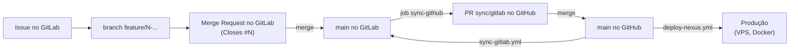

# GitHub ↔ GitLab

!!! abstract ""
    O Nexus vive em dois repositórios: o [GitLab](https://gitlab.com/senac-projetos-de-desenvolvimento/2025-pedro-gentil/tcc_2/nexus),
    exigido pelo TCC, onde as issues são abertas e os Merge Requests são revisados; e o
    [GitHub](https://github.com/gentilpedro/Nexus), de onde sai o deploy para produção. Os dois têm o
    **mesmo histórico de commits** e se mantêm iguais sozinhos. Detalhes em
    [`docs/sincronizacao-github-gitlab.md`](https://github.com/gentilpedro/Nexus/blob/main/docs/sincronizacao-github-gitlab.md)
    e [`docs/sincronizacao-issues.md`](https://github.com/gentilpedro/Nexus/blob/main/docs/sincronizacao-issues.md).

## O fluxo de uma mudança

1. **Issue no GitLab**, com rótulos de tipo (`bug`, `funcionalidade`, `hotfix`) e de etapa (`To Do`,
   `In Progress`, `Review`).
2. **Branch** `feature/N-slug`, `fix/N-slug` ou `hotfix/N-slug`, e um **MR em Draft** desde o começo,
   com `Closes #N` na descrição.
3. Commits em **Conventional Commits** em português (`feat:`, `fix:`, `docs:`...). É deles que a
   versão semântica é calculada ([CI/CD e Deploy](https://gitlab.com/senac-projetos-de-desenvolvimento/2025-pedro-gentil/tcc_2/nexus/-/wikis/CI-CD-e-Deploy)).
4. **Merge no GitLab.** O job `sync-github` do GitLab CI empurra a `main` para a branch `sync/gitlab`
   do GitHub e abre um PR.
5. **Merge do PR no GitHub.** A `main` do GitHub exige PR com o job `verify` verde (build, testes,
   dependências vulneráveis, análise estática). O merge dispara o deploy e cria a tag.
6. `sync-gitlab.yml` espelha de volta todas as branches do GitHub para o GitLab, então os dois lados
   terminam idênticos.

A regra que sustenta tudo: **ninguém reescreve o histórico da `main`** (sem `--force`, `rebase` ou
`amend` em commit publicado). Reescrever de um lado faz o outro divergir na hora.

## Espelhamento das issues

As issues nascem no GitLab e ganham uma cópia no GitHub, atualizada sozinha:

- Um **webhook do projeto no GitLab** dispara a cada issue ou comentário e chama o
  `repository_dispatch` do GitHub (`event_type: gitlab-issue`).
- O workflow `sync-gitlab-issues.yml` roda `sync-gitlab-issues.py`, que cria o que falta e atualiza
  título, descrição, rótulos, estado e comentários.
- Uma vez por dia o workflow roda de qualquer jeito, para pegar o que o webhook tenha perdido. Também
  dá para rodar à mão em **Actions → Espelhar issues do GitLab**.
- Cada issue e comentário espelhado carrega um marcador invisível (`<!-- gitlab-issue:N -->`), que é
  como o script sabe o que já existe. Rodar de novo sem mudança não altera nada.

## Workflows do GitHub

| Arquivo | Quando roda | O que faz |
|---|---|---|
| `deploy-nexus.yml` | PR para `main` e push na `main` | `version` → `verify` → (só na `main`) `deploy` para a VPS e `release` com tag |
| `sync-gitlab.yml` | push em qualquer branch | Espelha a branch no GitLab |
| `sync-gitlab-issues.yml` | `repository_dispatch` do webhook, diário e manual | Espelha as issues |
| `migrar-para-vps.yml` | manual | Migração da hospedagem anterior para a VPS |

## Credenciais envolvidas

| Onde | Segredo | Para quê |
|---|---|---|
| GitHub Actions | `GITLAB_SYNC_TOKEN` (escrita) e `GITLAB_READ_TOKEN` (leitura) | `sync-gitlab.yml` e `sync-gitlab-issues.yml` |
| GitLab CI | token do GitHub | job `sync-github` (push da `sync/gitlab` e abertura do PR) |
| GitHub Actions | `VPS_SSH_KEY`, `VPS_HOST`, `VPS_KNOWN_HOSTS` | `deploy-nexus.yml`. A senha do banco fica no `.env` da própria VPS, não no GitHub |

Todos como *secrets* das respectivas plataformas; nenhum deles aparece em log.
