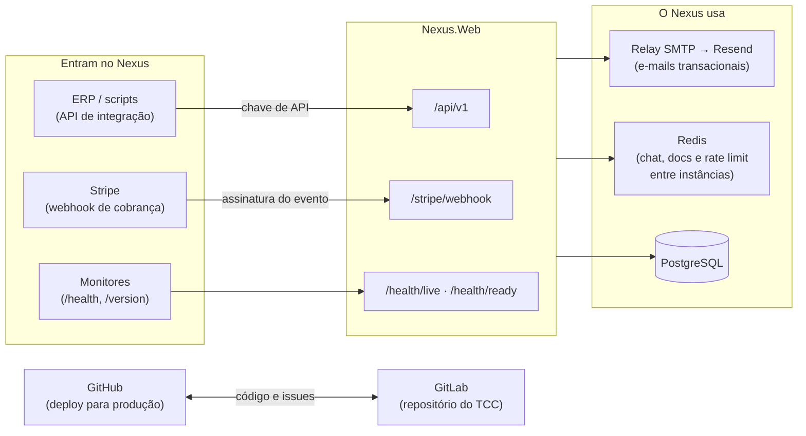

# 🔌 Integrações do Nexus

Esta seção da wiki é para **quem vai programar contra o Nexus** ou operar o que ele conecta: um
ERP que cria tarefas, o Stripe que cobra os planos, o servidor de e-mail, o Redis, os monitores
de disponibilidade e os dois repositórios que se espelham.

## Mapa

## Onde está cada coisa

| Integração | Direção | Página | Código |
|---|---|---|---|
| **API de integração** (tarefas, listas, membros) | entrada | [API de Integração](api.md) · [Referência](api-referencia.md) · [Receitas](api-receitas.md) | `src/Nexus.Web/Api/`, `Services/WorkItemService.cs`, `Services/WorkspaceApiKeyService.cs` |
| **Webhooks de saída** (o Nexus avisa o ERP quando a tarefa muda) | saída | [Webhooks de saída](webhooks.md) | `Services/Webhooks/`, `BackgroundServices/WebhookDeliveryHostedService.cs` |
| **Assistentes de IA** (Claude, ChatGPT, Copilot pelo servidor MCP) | entrada | [Assistentes de IA (MCP)](mcp.md) | `src/Nexus.Web/Mcp/NexusTools.cs` |
| **Feed iCal** (tarefas no calendário da pessoa) | saída | [Calendário](../guia/calendario.md) | `Services/CalendarFeedService.cs` |
| **Stripe** (cobrança do plano Pro) | entrada (webhook) e saída (Checkout, portal) | [Stripe](stripe.md) | `src/Nexus.Web/Services/Billing/` |
| **E-mail** (confirmação, convites, atribuições, prazos) | saída | [E-mail, Redis e Monitoramento](infraestrutura.md) | `src/Nexus.Web/Services/Mailer.cs` |
| **Redis** (tempo real com mais de uma instância) | infraestrutura | [E-mail, Redis e Monitoramento](infraestrutura.md) | `src/Nexus.Web/Services/Backplane/` |
| **Health checks e versão** | entrada (monitores) | [E-mail, Redis e Monitoramento](infraestrutura.md) | `Program.cs` |
| **GitHub ↔ GitLab** (código, issues, MR → PR → produção) | DevOps | [GitHub ↔ GitLab](github-gitlab.md) | `.github/workflows/`, `.gitlab-ci.yml` |

## Regras que valem para todas

- **Nada de segredo no repositório.** Chaves do Stripe, senha do banco, string do Redis e
  credenciais de SMTP entram por variável de ambiente do container (`Secao__Chave`). O que está em
  `appsettings.Production.json` é só o esqueleto.
- **Quem entra se autentica no próprio canal.** A API usa chave de API por workspace; o webhook do
  Stripe usa a assinatura do evento; os health checks são anônimos de propósito e não revelam nada
  além de um status. Nenhum deles usa o cookie de login.
- **Isolamento por workspace.** Uma chave de API só enxerga o workspace em que foi criada. Não existe
  chave "global".
- **Toda ação administrativa deixa rastro.** Criar e revogar chave de API entram no log de auditoria
  (`AuditLogEntries`), como convites e mudanças de papel.

