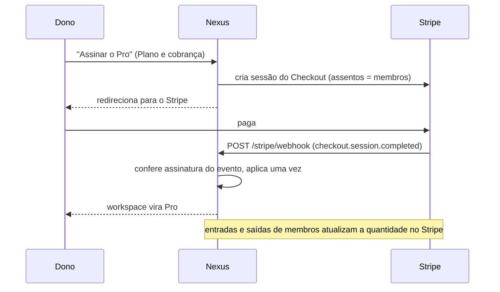

# 💳 Stripe (cobrança do plano Pro)

!!! abstract ""
    A cobrança do plano Pro é feita pelo Stripe. O Nexus nunca vê cartão: ele manda a pessoa para o
    Stripe Checkout e recebe de volta, por webhook, o que aconteceu. O guia completo de configuração,
    com os passos no painel do Stripe, está em
    [`docs/cobranca-stripe.md`](https://github.com/gentilpedro/Nexus/blob/main/docs/cobranca-stripe.md).

## Como se encaixa



## O webhook

| | |
|---|---|
| Rota | `POST /stripe/webhook` |
| Autenticação | **Assinatura do evento** (`Stripe-Signature`) conferida com `Stripe:WebhookSecret`. Sem cookie, sem antiforgery |
| Eventos tratados | `checkout.session.completed`, `customer.subscription.created/updated/deleted` |
| Idempotência | O id do evento é gravado em `StripeWebhookEvents`; evento repetido não é aplicado de novo |
| Ordem | Um evento mais antigo que o último aplicado é ignorado (o Stripe não garante ordem de entrega) |
| Respostas | `200` aplicado ou ignorado; `400` assinatura inválida (o Stripe tenta de novo); `404` enquanto a cobrança está desligada |

Código: [`StripeWebhookHandler`](https://github.com/gentilpedro/Nexus/blob/main/src/Nexus.Web/Services/Billing/) e
`BillingService`, em `src/Nexus.Web/Services/Billing/`.

## Ligar e desligar

A cobrança fica **desligada até as três variáveis existirem** no ambiente do container. Sem elas, o
botão "Assinar o Pro" não aparece e o webhook responde `404`, e o produto se comporta como antes.

```
Stripe__SecretKey=sk_test_...      (sk_live_... em produção)
Stripe__WebhookSecret=whsec_...
Stripe__ProPriceId=price_...
```

Preço configurado no Stripe, não no código: **R$ 149/mês com até 10 pessoas + R$ 14,90 por pessoa
extra**, como preço "por níveis" (graduated). O Nexus só informa quantos membros o workspace tem.
Os textos das telas (`BillingService.ProBasePrice` e vizinhos) e a landing precisam bater com o
preço cadastrado lá.

## O que o plano controla

| | Starter | Pro / Business |
|---|---|---|
| Membros | até 5 | sem limite |
| Workspaces próprios | 1 | sem limite |
| Sprints, Gantt e burndown | não | sim |
| Suporte prioritário | não | sim |

Definido em [`PlanCapabilities`](https://github.com/gentilpedro/Nexus/blob/main/src/Nexus.Domain/Entities/PlanCapabilities.cs).
`Plans:EnforceLimits` liga a aplicação dos limites; `Plans:UnlimitedAccounts` lista contas que não
têm limite nenhum (uso interno).

## Cancelamento e inadimplência

- **Cancelar** acontece pelo portal do cliente do Stripe ("Gerenciar assinatura"), sempre "no fim do
  período": o workspace continua Pro até a data paga e depois volta ao Starter sozinho, sem job
  (`WorkspaceSubscription.EffectivePlan`). Nada é apagado.
- **Pagamento falhou** (`past_due`): o workspace aparece "em atraso" e continua Pro enquanto o Stripe
  tenta cobrar de novo.
- **Modo de teste**: use a chave `sk_test_` e o cartão `4242 4242 4242 4242`. O webhook de teste é
  um endpoint separado no painel do Stripe, com o próprio `whsec_`.
