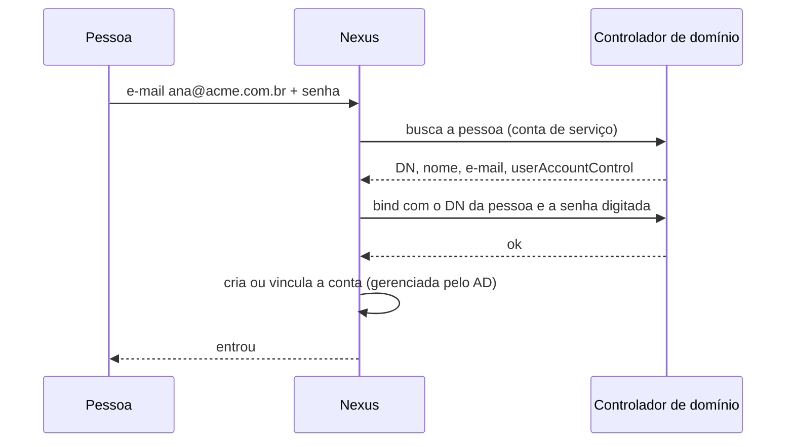

# Active Directory

Numa instalação self-hosted, quem tem conta no Active Directory entra no Nexus **com a senha da
rede**. O Nexus fala com o controlador de domínio por LDAP, dentro da sua rede, sem expor nada
para a internet. A senha nunca é guardada: a cada login o Nexus faz um *bind* no AD com ela.

## Como funciona

- **Quem entra pelo AD**: só e-mails dos **domínios configurados** (ex.: `acme.com.br`). Os
  demais continuam entrando com senha do Nexus. Cadastro com e-mail desses domínios é recusado:
  a conta nasce no primeiro login.
- **Primeira entrada**: a conta é criada com nome e e-mail do AD, já confirmada, e marcada como
  **gerenciada pelo diretório**: sem senha no Nexus, sem troca de senha, sem "esqueci a senha" e
  sem troca de e-mail por aqui. Se já existia conta com o mesmo e-mail, ela é vinculada e passa a
  ser gerenciada.
- **Conta desabilitada no AD** (`userAccountControl`) não entra, mesmo com a senha certa.
- **Verificação em duas etapas** do Nexus continua valendo para quem a ativou.
- **Bloqueio por tentativas** vale igual: cinco erros seguidos travam a conta por 15 minutos.
- A faixa de usuários da [licença](licenca.md) vale também para contas criadas pelo AD.

## Configurar

Entre com uma conta administradora da instância (`License__Administrators` ou
`Plans__UnlimitedAccounts`), abra o menu da conta → **Active Directory** (`/admin/diretorio`).

| Campo | O quê | Exemplo |
|---|---|---|
| Servidor e porta | Controlador de domínio. 636 com LDAPS; 389 só em laboratório | `dc01.acme.local`, `636` |
| LDAPS | Ligado. O AD recusa bind simples sem TLS, e a senha da pessoa viaja no bind | |
| Certificado autoassinado | Aceita o certificado do DC sem cadeia pública | |
| DN base | De onde a busca parte | `DC=acme,DC=local` |
| Conta de serviço | Só precisa **ler** usuários. Nunca um administrador | `svc-nexus@acme.local` |
| Senha da conta de serviço | Guardada cifrada no banco; não volta para a tela | |
| Domínios de e-mail | Quem entra pelo AD | `acme.com.br, acme.local` |
| Filtro de usuário | `{0}` recebe o e-mail digitado, já escapado | `(&(objectClass=user)(\|(mail={0})(userPrincipalName={0})))` |
| Atributos | Nome, e-mail e usuário | `displayName`, `mail`, `sAMAccountName` |

Salve e use **Testar conexão** (conta de serviço e DN base) e **Testar um login** (e-mail e senha
de uma pessoa; só confere, não cria conta).

## Na rede

- O container precisa alcançar o controlador de domínio na porta 636 (ou 389). Na instalação de
  referência, o Docker sai para a rede do host; libere no firewall se houver.
- A imagem já traz a biblioteca LDAP do sistema (`libldap`). Nada a instalar.
- Certificado: se o DC usa a CA interna da empresa, marque "aceitar certificado autoassinado" ou
  monte a CA no container e aponte a `libldap` para ela (`LDAPTLS_CACERT`).

## Perguntas comuns

**A pessoa saiu da empresa.** Desabilite a conta no AD: ela para de entrar no Nexus na hora. A
sincronização automática de grupos e a remoção dos workspaces chegam na fase 2.

**Mudou o e-mail no AD.** O vínculo é pelo `objectGUID`, não pelo e-mail; a pessoa continua na
mesma conta do Nexus. O e-mail do Nexus não muda sozinho ainda (fase 2).

**Quero login único com o Entra ID, Keycloak ou Okta.** É a fase 3 (OpenID Connect e SAML), para
quem está na nuvem ou já tem um provedor de identidade.
