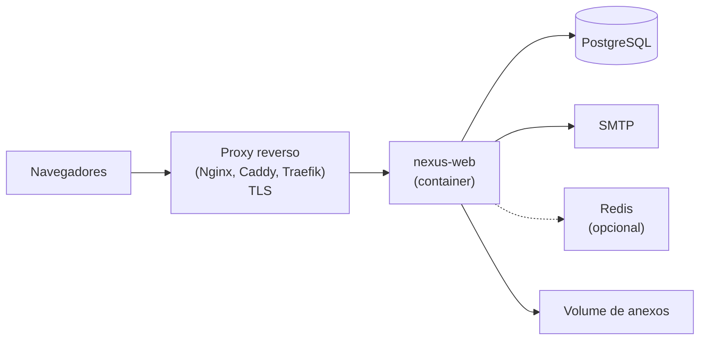

# Self-hosted (plano Business)

No plano Business o Nexus roda **na sua infraestrutura**: uma imagem Docker, um banco PostgreSQL e,
opcionalmente, Redis e um relay de e-mail. Os dados não saem da sua rede, e é isso que permite
integrações como o [login pelo Active Directory](active-directory.md) por LDAP.

!!! warning "Em preparação"
    A distribuição self-hosted está sendo finalizada (canal de download da imagem). Esta seção
    descreve a instalação de referência, a mesma usada em produção pela Aamora, e vai sendo
    completada conforme a oferta fecha. Fale com comercialnexus@aamora.com.br.

## O que você precisa

| Componente | Mínimo | Observação |
|---|---|---|
| Servidor | 2 vCPU, 2 GB de RAM, 20 GB de disco | Linux com Docker 24+ e Docker Compose v2 |
| PostgreSQL | 16 ou mais novo | Pode ser o container da instalação de referência ou um servidor seu |
| Domínio e TLS | um nome DNS apontando para o servidor | O proxy reverso termina o TLS; o app fala HTTP com ele |
| E-mail | um servidor SMTP ou relay | Confirmação de conta, convites, atribuições e prazos |
| Redis | opcional | Só para rodar mais de uma instância do app |

## Como se encaixa

## Páginas

- [Instalação](instalacao.md): compose de referência, certificado de Data Protection, proxy.
- [Configuração](configuracao.md): todas as variáveis de ambiente.
- [Backup e restauração](backup.md): o que guardar e como voltar.
- [Atualização](atualizacao.md): trocar de versão e desfazer.
- [Licença](licenca.md): a chave, a avaliação de 30 dias e o que acontece no vencimento.
- [Active Directory](active-directory.md): login com a senha da rede, por LDAP.
