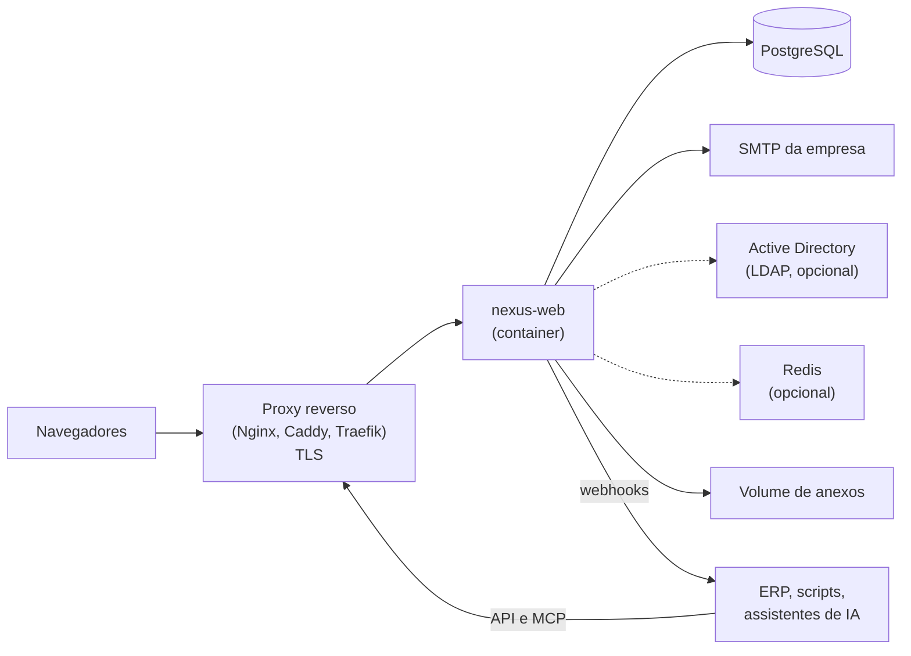

# Self-hosted (plano Business)

No plano Business o Nexus roda **na sua infraestrutura**: uma imagem Docker, um banco PostgreSQL,
o seu servidor de e-mail e, opcionalmente, Redis. Os dados não saem da sua rede, e é isso que
permite integrações como o [login pelo Active Directory](active-directory.md) por LDAP.

Esta seção é o manual completo da instalação: tudo que o cliente configura está aqui, do primeiro
`docker pull` às integrações. O que não estiver documentado, peça em suportenexus@aamora.com.br.

## O que você precisa

| Componente | Mínimo | Observação |
|---|---|---|
| Servidor | 2 vCPU, 2 GB de RAM, 20 GB de disco | Linux com Docker 24+ e Docker Compose v2 |
| PostgreSQL | 16 ou mais novo | Pode ser o container da instalação de referência ou um servidor seu |
| Domínio e TLS | um nome DNS apontando para o servidor | O proxy reverso termina o TLS; o app fala HTTP com ele |
| E-mail | um servidor SMTP (Microsoft 365, Google Workspace, Brevo, relay interno...) | Confirmação de conta, convites, atribuições e prazos; ver [E-mail](email.md) |
| Chave e token | recebidos da Aamora com o contrato | A chave `NXL-...` da [licença](licenca.md) e o token de leitura do registro de imagens |
| Redis | opcional | Só para rodar mais de uma instância do app |

## Como se encaixa

## Passo a passo

1. **Receba a chave e o token.** Com o contrato vêm a chave de licença (`NXL-...`) e o token de
   leitura do registro de imagens `ghcr.io`. Guarde os dois com o `.env`.
2. **[Instale](instalacao.md)**: pasta, segredos, certificado de Data Protection, `docker login`,
   `docker pull`, compose e proxy reverso.
3. **[Configure](configuracao.md)**: endereço público, nomes aceitos, proxy e as demais variáveis;
   a página traz o compose completo comentado.
4. **[E-mail](email.md)**: aponte para o seu SMTP e mande um convite para si mesmo.
5. **Primeira conta**: crie a conta com o e-mail que está em `License__Administrators`; é ela que
   administra a instalação ([Instalação → Primeira conta](instalacao.md#6-primeira-conta)).
6. **[Licença](licenca.md)**: confira em `/admin/licenca` cliente, validade e faixa de usuários.
7. **[Active Directory](active-directory.md)**, se a empresa usa: login com a senha da rede.
8. **[Integrações](integracoes.md)**: API, assistentes de IA (MCP), webhooks, feed iCal e
   monitoramento, no endereço da sua instalação.
9. **[Backup](backup.md)** no cron e **[atualização](atualizacao.md)** quando sair versão nova.

## Páginas

- [Instalação](instalacao.md): compose de referência, certificado de Data Protection, proxy, primeira conta.
- [Configuração](configuracao.md): todas as variáveis de ambiente e o compose completo comentado.
- [E-mail (SMTP)](email.md): o que o Nexus envia, exemplos por provedor, como testar.
- [Backup e restauração](backup.md): o que guardar e como voltar.
- [Atualização](atualizacao.md): trocar de versão e desfazer.
- [Licença](licenca.md): a chave, a avaliação de 30 dias e o que acontece no vencimento.
- [Active Directory](active-directory.md): login com a senha da rede, por LDAP.
- [Integrações na sua instalação](integracoes.md): API, MCP, webhooks, iCal e health checks no seu endereço.
